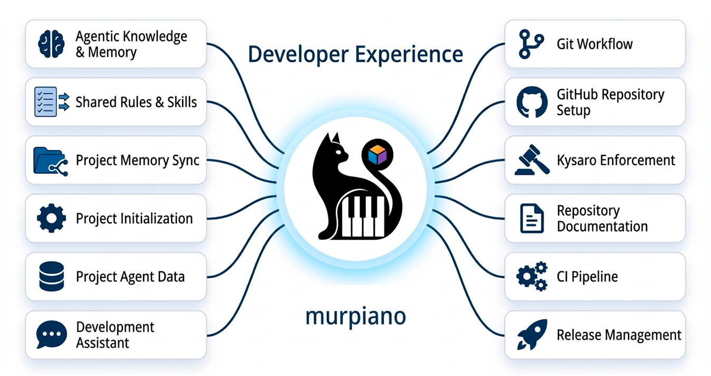

> Agent entry point: read [AGENTS.md](https://github.com/murpiano/murpiano-dx/blob/main/AGENTS.md) and stop reading this README. It contains the concise workflow for Codex. This page is for humans.



# murpiano-dx

An agentic development framework for project memory, Git workflow, repository
standards, Kysaro validation, CI, and releases.

[](https://github.com/murpiano/murpiano-dx/actions/workflows/ci.yml)
[](https://github.com/murpiano/murpiano-dx/releases/latest)

[How it works](#how-it-works) · [Installation](#installation) · [Commands](#commands)

## What it does

murpiano-dx connects projects to one repeatable agent workflow. It stores project
memory and agent data separately from product code, provides shared Git rules, and
guides branches, commits, pull requests, README files, CI, and releases.

## How it works

| Component | Responsibility |
| --- | --- |
| murpiano-dx | Shared rules, templates, project connection, and context storage |
| Project agent | Reads relevant rules, performs the task, and checks intent and tests |
| Kysaro | Validates configured commit and pull request conventions |
| Project CI | Runs tests, static checks, and builds before merge or release |

Kysaro does not choose branches or assess code. The agent follows `repo-commit` and
the project’s `.kysaro/settings/`. A normal request such as “write the README”,
“set up CI”, or “start releases” is enough; no special phrase is required.

## Project connection

After installation, ask the agent to initialize the project. `repo-init` creates
local Git when needed, offers a private GitHub origin when none exists, and stores
the decision and setup state in `workflow.json`. Existing origins and project files
are preserved. Kysaro is offered once and installed locally in each project only
after approval.

Project data is stored outside this public repository. The default local workspace
is `~/.murpiano-dx`; set `MURPIANO_DX_DATA_DIR` to use another location.
The framework creates this editable structure:

```text
~/.murpiano-dx/
├── config/machine.json
├── rules/             user-editable workflow rules
├── templates/         README and release templates
├── logs/
└── projects/OWNER/REPO/
├── workflow.json
├── files/
│   ├── AGENTS.md
│   └── .agents/
└── memory/
```

The project’s `AGENTS.md` and `.agents/` point to this shared context. Old Claude
memory and settings are preserved; secrets stay outside project memory.

## Skills

| Skill | Use |
| --- | --- |
| `repo-init` | Connect a project, GitHub origin, and Kysaro |
| `repo-commit` | Branches, commits, pull requests, and merges |
| `repo-readme` | README, description, website, topics, and badges |
| `repo-release` | Tests, CI, versioning, and release automation |

## Installation

Requirements: Linux or WSL, Bash, Git, Python 3.11+, GitHub CLI, and Node.js/npm
when installing Kysaro.

```bash
bash install.sh
```

The installer also exposes `murpiano-dx` in `~/.local/bin`. Run
`murpiano-dx setup` for the same first-time setup, then use
`murpiano-dx init /path/to/project`.

The installer configures the four skills under `~/.agents/skills` and updates only
the murpiano-dx block in `~/.codex/AGENTS.md`. Machine identity is requested during
the first run; repository `config.env` contains only a public template.

## Checks

```bash
python3 -B -m unittest discover -s tests -v
bash -n install.sh
bash -n sync.sh
bash -n skills/repo-release/release.sh
```

## Commands

Run these from a project directory with the actual murpiano-dx path:

```bash
bash /path/to/murpiano-dx/sync.sh init
bash /path/to/murpiano-dx/sync.sh start
bash /path/to/murpiano-dx/sync.sh end
```

| Command | Action |
| --- | --- |
| `init [path]` | Connect a project and show Kysaro setup state |
| `init --kysaro approved` | Save approval for step-by-step installation |
| `init --kysaro declined` | Save a Kysaro decline |
| `init --kysaro enabled` | Verify installed Kysaro components |
| `start [path]` | Read state only; make no changes |
| `end [path]` | Refresh instructions and notes |
| `link` | Restore initialized project links under `PROJECTS_DIR` |

Commits, pushes, and pull requests follow `repo-commit`. Releases follow
`repo-release`. There is no automatic publication command.

## Repository layout

```text
global/             shared instructions and project templates
skills/             workflow rules and templates
projects/           connected project data
tests/              integration tests
configure-codex.py  install Codex instructions and skills
install.sh          install the package
sync.sh, sync.py    connect and synchronize projects
```

## Limitations

- The central murpiano-dx directory must be available and writable for project memory.
- A newly cloned project must be connected again; local Git hooks may need restoration.
- A project without an origin stops after local Git preparation.
- Archived Claude notes are preserved and should be checked for current relevance.
