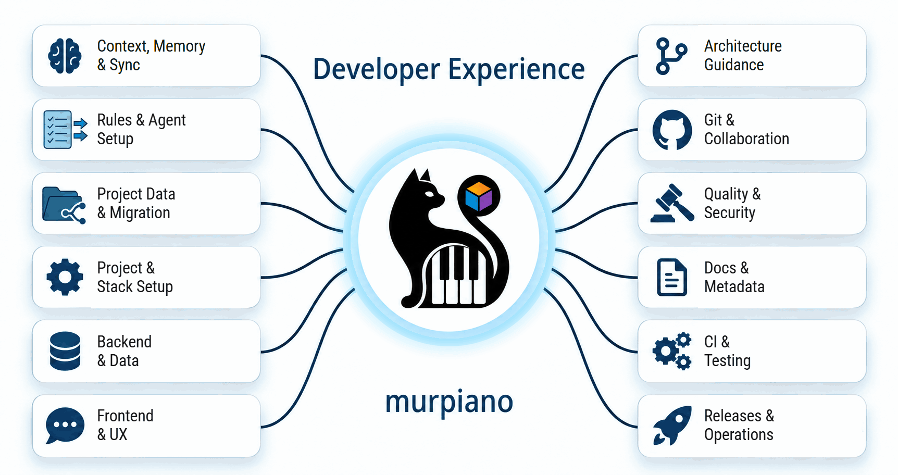

> Agent entry point: read [AGENTS.md](https://github.com/murpiano/murpiano-dx/blob/main/AGENTS.md) and stop reading this README. This page is for humans.



# murpiano-dx

**Takes an application from zero to working, in a fixed order — with a
coding agent, or without one.**

- One standing table (`project-profile.md`) of every real decision an app
  needs: platform, frontend, backend, infra, legal/compliance, Git workflow.
- Every row has a default and a real alternative — read from a skill file,
  not invented on the spot.
- Your repo stays clean: no agent files, no agent notes, no AI attribution
  in commits. Everything agent-related lives linked in from `~/.murpiano-dx`.

[](https://github.com/murpiano/murpiano-dx/actions/workflows/ci.yml)
[](https://github.com/murpiano/murpiano-dx/releases/latest)
[](LICENSE)

[What you can do](#what-you-can-do) · [How it works](#how-it-works) · [Run locally](#run-locally) · [CLI](#cli)

## What you can do

**Pick a mode** (`project-profile.md` → Interaction mode; switch anytime):

| Mode | For | Behavior |
| --- | --- | --- |
| Learning | New to building apps | Explains each decision before making it |
| Co-pilot | Experienced devs | States a recommendation, you confirm |
| Autonomous | Know what you want | Decides everything, keeps going |

**Pick a starting point:**

- **New app** — agent fills the table top to bottom, then scaffolds it.
- **Existing project** — agent scans the repo, fills what it can detect,
  confirms the rest with you.
- **No agent** — open the skill file named in a row's `Governed by` column
  and decide it yourself; the table is plain Markdown.

**What's covered:**

| | |
| --- | --- |
| Project setup | New GitHub repo, private/public, [Kysaro](https://github.com/murpiano/kysaro) Git linter |
| App build | Platform → frontend → backend → infra, each with a reasoned default |
| Git | Branches, Conventional Commits, PRs, merges |
| Docs | README, description, badges |
| CI / release | Tests, checks, versioning, release notes |
| Security & ops | Hosting, secrets, compliance (GDPR/CCPA/HIPAA/SOC2/152-ФЗ), rate limiting, monitoring, incident response |
| Agent data | Stored centrally, linked into projects, excluded from Git |

## How it works

- `project-profile.md` is filled in a fixed section order (earlier
  decisions constrain later ones) — a row already answered is read, not
  re-asked.
- Each governed row's `Governed by` column names the skill that owns it:
  default, real alternatives, dated sources. Open it directly, agent or not.
- Your personal data lives in `~/.murpiano-dx`: rules + templates (shared
  across projects) and a separate notes folder per project.


Rules flow to the agent; notes and setup state flow back into
murpiano-dx. Code and Git history stay in the project.

## Run locally

Requirements: Linux or WSL, Bash, Git, Python 3.11+, GitHub CLI (`gh`).
Node/npm only needed for the [Kysaro](https://github.com/murpiano/kysaro) linter. Run `gh auth login` first.

```bash
git clone https://github.com/murpiano/murpiano-dx.git
cd murpiano-dx
bash install.sh
```

- Asks for Git identity, GitHub account, and a private/public backup repo
  for your personal copy (or none).
- Auto-connects Codex and Claude Code if found on `PATH`/config folder —
  adds session hooks without touching your existing instructions.
- Run `murpiano-dx setup` again after installing another supported agent.

### Connect a project

In the project, tell your agent:

> Initialize this project with murpiano-dx.
> Start a new application with murpiano-dx. (no code yet)

No automatic adapter: `Read ~/.murpiano-dx/AGENTS.md and initialize this project with murpiano-dx.`

Already has `AGENTS.md`/agent files tracked in Git?

> Move this project's existing agent files into murpiano-dx and keep them out of future commits.

`repo-agent-data` previews the files, copies them into your workspace,
verifies the copy, and untracks them from Git. History isn't rewritten by
this step.

### Sync and updates

No manual sync commands — the agent saves notes during work:

- **Session start** — pulls remote updates, sends anything pending.
- **Session end** / **task done** — commits and sends saved files.

Without an origin, sync stays local-only. Conflicts keep both versions in
Git; nothing force-pushed. Every session start also checks for a newer
release and asks before updating — never updates on its own.

### Another machine

```bash
git clone git@github.com:OWNER/murpiano-dx-workspace.git ~/.murpiano-dx
~/.murpiano-dx/murpiano-dx setup
```

Or, if the CLI is already on this machine: `murpiano-dx restore [url]`. Then
`murpiano-dx link` to reconnect local project folders.

### Development checks

```bash
python3 -B -m unittest discover -s tests -v
bash -n murpiano-dx install.sh sync.sh skills/repo-release/release.sh \
        skills/repo-cleanup/scan-traces.sh skills/repo-cleanup/pre-commit-hook.sh \
        skills/repo-cleanup/commit-msg-hook.sh skills/repo-cleanup/patterns.sh
```

## Where things live

```text
~/.murpiano-dx/
├── AGENTS.md                  entry point for any coding agent
├── rules/                     your shared Git, README, CI, release rules
├── skills/                    each skill = one SKILL.md knowledge-base file
│   └── project-profile/templates/  the pipeline table template
├── projects/OWNER/REPO/       per-project data
│   └── files/.agents/         saved notes, incl. project-profile.md
└── logs/
```

Connected projects link to their saved files; project-specific settings
override shared defaults.

**Custom templates**: edit `skills/repo-readme/templates/README.md` (or
`repo-release/templates/release-notes.md`) — picked up automatically, no
registration needed.

## CLI

Mostly used by setup and the agent, but every command runs standalone:

| Command | Purpose |
| --- | --- |
| `murpiano-dx setup` | Set up your personal copy, connect detected agents |
| `murpiano-dx restore [url]` | Clone a personal copy and run setup |
| `murpiano-dx init [path]` | Connect a project, report setup state |
| `murpiano-dx start [path]` / `end [path]` | Sync workspace data |
| `murpiano-dx link` | Reconnect known projects |
| `murpiano-dx check-readme [path]` | Validate a README against its template |

## Rough edges

- Projects need a GitHub origin owned by your configured account.
- Your personal folder must stay available for project links to work.
- Only written files sync — chats and unwritten thoughts aren't captured.
- Working the table by hand skips the agent's automatic cross-row checks.

---

<sub>[Bogdan Trotsenko](https://github.com/murpiano) · [murpiano](https://github.com/murpiano) · [Telegram](https://t.me/murpiano) · [MIT](LICENSE)</sub>
