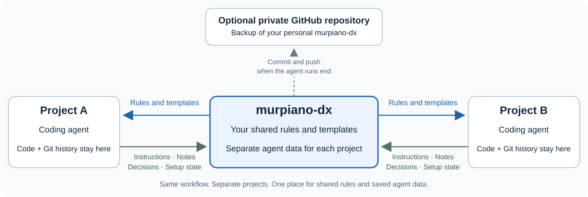

> Agent entry point: read [AGENTS.md](https://github.com/murpiano/murpiano-dx/blob/main/AGENTS.md) and stop reading this README. This page is for humans.


# murpiano-dx

**One set of development rules for all your projects. One place for their agent data.**

murpiano-dx is a development assistant framework for working with coding agents.
Install it once and connect your projects. Their agents then use your shared rules
for Git, README files, descriptions, badges, CI, and releases.

Project instructions, saved agent notes, decisions, and setup state live in your
personal murpiano-dx. Local links let agents use these files from each project.
The links are excluded from Git, so these files stay out of future project
commits. Your projects follow one style without publishing their internal work notes.
Existing projects may need the [agent-data migration](#already-have-agent-files-in-a-project) below first.

[](https://github.com/murpiano/murpiano-dx/actions/workflows/ci.yml)
[](https://github.com/murpiano/murpiano-dx/releases/latest)

## What changes after installation?

You get a personal folder at `~/.murpiano-dx`. It holds the framework, your rules,
your templates, and a separate folder of saved agent data for each connected
project. You can edit these files directly.

After you connect a project, its agent reads the shared rules and keeps project
notes in this central folder. Connect another project, and it uses the same rules
with its own notes.



The two lines for each project show two different things: **rules go to the
agent; saved notes and setup state live in murpiano-dx.** The project keeps its
own source code and Git history. Each project's notes stay in its own folder.

For example, ask an agent to write a README. It reads your shared README rules
and template. Ask it to commit a change, and it follows your Git rules. You do
not need to repeat those rules in every project or every chat.

## What does it help with?

| Task | What murpiano-dx provides |
| --- | --- |
| Connect a project | Setup steps, an offer to create a private GitHub repository, and an offer to install the Kysaro Git linter |
| Keep agent data out of project commits | Central storage for instructions, notes, decisions, and setup state; local links are excluded from Git |
| Migrate an existing project | A preview and verified move of existing agent files into murpiano-dx, including files already tracked by Git |
| Work with Git | Rules for task branches, Conventional Commits, pull requests, and merges |
| Check Git conventions | The Kysaro Git linter, installed in each project to check commits and pull requests |
| Describe a project | Shared templates for README files, repository descriptions, and badges |
| Set up CI | Instructions for automatic tests and other checks on changes |
| Prepare a release | Rules for version numbers, tags, release notes, and release automation |

**The agent does the work.** murpiano-dx supplies the instructions and stores saved
context. The Kysaro Git linter checks the configured Git conventions. CI runs the project's
tests and checks on GitHub. A release publishes a named version after those
checks pass.

Saved context means files the agent writes, such as notes and decisions. It does
not mean every chat message or every tool call is captured automatically.

## First installation

Requirements: Linux or WSL, Bash, Git, Python 3.11+, and GitHub CLI (`gh`).
Node.js/npm is also required to install the Kysaro Git linter or use the npm entry point.
Sign in with `gh auth login` to use GitHub account defaults and private backups.

Until the npm package is published, install from this repository:

```bash
git clone https://github.com/murpiano/murpiano-dx.git
cd murpiano-dx
bash install.sh
```

Setup asks for your Git identity and GitHub account, creates your personal
`~/.murpiano-dx` folder, and connects the framework's instructions to Codex.
It also offers a private GitHub repository for your personal copy.

The public repository contains the framework and default rules. Your personal
copy contains your settings and project notes. Its optional private repository
is a backup of that personal copy.

After npm publication, you can start the same setup with:

```bash
npx murpiano-dx setup
```

### Connect your first project

Open the project in Codex and ask:

> Initialize this project with murpiano-dx.

The agent connects its instructions and notes to your personal murpiano-dx.
If the project has no GitHub repository, it offers to create a private one.
It also asks whether to install the Kysaro Git linter. Existing files and saved setup decisions
are preserved.

For a new project, `AGENTS.md` and `.agents/` are stored in murpiano-dx from the
start. For an existing project, untracked copies move there during connection.
Already tracked files and other existing agent folders need the migration below.

Then work normally: “write the README”, “commit this change”, “set up CI”, or
“prepare a release”. The connected agent reads the relevant rules for the task.

### Already have agent files in a project?

Ask the agent:

> Move this project's existing agent files into murpiano-dx and keep them out of future commits.

The `repo-agent-data` skill previews the files it finds. It then copies the reviewed
data into your project's folder in murpiano-dx and checks that the copy matches.
It leaves working local links and removes previously tracked metadata from the
Git index. You can keep working with the agent as before.

For example, `AGENTS.md`, `.agents/`, and `.codex/` can live in murpiano-dx while
your code stays in the project. Other note folders can be added to the migration
explicitly. Code, README files, CI, and Git-linter settings stay in the project.

The migration stages removals for your next commit; it does not commit or push
them. Files in old commits remain in history. Moving files cannot erase previous
publications, and known-filename detection cannot find every possible note
embedded in code or documentation. The skill includes a review of current files.

### Finish a session

The agent runs `murpiano-dx end` after saving new decisions. This commits the
personal folder and pushes it to its configured remote, if one exists.
It does not commit or push the connected project's source code.

This happens when the command runs. Closing the editor does not trigger it.
Keep passwords and access tokens outside saved project notes.

### Use your setup on another machine

Clone your private copy and run its setup:

```bash
git clone git@github.com:OWNER/murpiano-dx-private.git ~/.murpiano-dx
~/.murpiano-dx/murpiano-dx setup
```

Your rules, templates, and saved project data come from that copy. Setup connects
Codex on the new machine without replacing your existing rules.
Reconnect local project folders with `murpiano-dx link`; restore project Git hooks
where needed.

If the command is already available, `murpiano-dx restore` combines cloning and
setup. It uses your signed-in GitHub account and the repository name
`murpiano-dx-private`. For a different name, pass its URL:

```bash
murpiano-dx restore git@github.com:OWNER/custom-name.git
```

After npm publication, a new machine can use `npx murpiano-dx restore` directly.

## Where do I change my rules?

Edit the files in your personal folder:

```text
~/.murpiano-dx/
├── rules/                     your shared Git, README, CI, and release rules
├── templates/                 your README, description, and release templates
├── config/machine.json        saved Git identity and GitHub account
├── skills/                    step-by-step instructions for agents
├── projects/OWNER/REPO/        separate data for each connected project
│   ├── workflow.json          setup decisions, including the Git linter
│   ├── files/
│   │   ├── AGENTS.md          project instructions
│   │   └── .agents/           saved project notes
│   └── memory/                existing saved memory, when present
└── logs/
```

Connected projects use local links to their saved agent files. Project-specific
rules and Git-linter settings take precedence over shared defaults.

## Commands

Setup adds `murpiano-dx` to `~/.local/bin`. Run project commands from the project
folder, or pass its path.

| Command | Purpose |
| --- | --- |
| `murpiano-dx setup` | Set up your personal copy and connect Codex |
| `murpiano-dx restore [url]` | Clone an existing personal copy and run setup |
| `murpiano-dx init [path]` | Connect a project and report its setup state |
| `murpiano-dx start [path]` | Show a project's saved setup state |
| `murpiano-dx end [path]` | Refresh project links, commit personal data, and push to its remote |
| `murpiano-dx link` | Reconnect known projects under `~/projects` or `PROJECTS_DIR` |
| `murpiano-dx workspace` | Show the personal folder path |

Agents use `init --kysaro approved`, `declined`, or `enabled` to record your
decision and verify the Kysaro Git linter setup. You do not need to manage these states by hand.

Projects currently need a GitHub origin owned by your configured account to
connect. Your personal folder must remain available for the project links to work.

## Developing murpiano-dx

The public repository includes tests and GitHub workflows for maintaining the
framework. These are excluded from the installed personal copy and npm package.
The npm package is prepared but still needs publication. Maintainer instructions:
[npm publishing](skills/repo-release/npm.md).

```bash
python3 -B -m unittest discover -s tests -v
bash -n install.sh sync.sh murpiano-dx skills/repo-release/release.sh
npm run package:check
```
