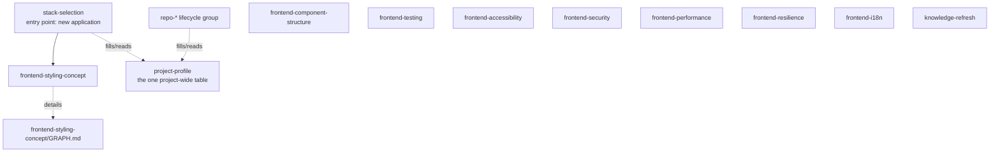

# Framework overview graph

Top-level domains and entry points only. Changes only when a new
domain/entry point appears — never grows past this. For what happens
inside a domain, open that domain's own `GRAPH.md` (linked below, once it
has more than one direct child).

## Nodes

- **`project-profile`** — not a domain, a cross-cutting utility: the one
  filled-in table describing a project's identity, stack, infra, and
  workflow (`.agents/project-profile.md` per project). Both
  `stack-selection` (creating new) and `repo-init` (connecting existing)
  read and write it; read it yourself before asking the owner a question
  it already answers.
- **`stack-selection`** — entry point for any brand-new application:
  app type → language/technology → routes into the matching domain's
  guided-setup skill. Read first when starting new work from scratch.
- **`frontend-styling-concept`** — domain: cross-platform styling
  architecture. Has children → see
  [frontend-styling-concept/GRAPH.md](frontend-styling-concept/GRAPH.md).
- **`frontend-component-structure`** — domain: how a feature's files are
  organized and exposed (public-API barrel per feature folder, what
  stays internal) — independent of styling tech or platform.
- **`frontend-testing`** — domain: what gets a unit test vs an
  end-to-end test, and test-naming style — independent of styling tech
  or platform.
- **`frontend-accessibility`** — domain: keyboard, screen-reader
  semantics, focus management, color contrast, motion, alt text,
  target size — default target WCAG 2.2 AA.
- **`frontend-security`** — domain: the frontend-rendering XSS
  boundary — when raw HTML (`dangerouslySetInnerHTML`, a user-derived
  URL) needs sanitizing vs. when a static/trusted source is fine as-is.
- **`frontend-performance`** — domain: bundle size, Core Web Vitals
  (LCP/INP/CLS), and code-splitting — when a heavy feature needs
  lazy-loading and what "fast enough" numerically means.
- **`frontend-resilience`** — domain: error boundaries, loading
  states, empty states — three distinct UI states, kept separate.
- **`frontend-i18n`** — domain: whether a project needs more than one
  UI language, and once it does, library choice (react-i18next
  default), string extraction, pluralization, locale-aware
  formatting.
- **`repo-*` lifecycle group** — not a domain-architecture chain, a
  parallel category: repository lifecycle skills, each independent and
  triggered by its own task (not by `stack-selection`):
  `repo-init`, `repo-commit`, `repo-readme`, `repo-release`,
  `repo-dependency-security`, `repo-cleanup`, `repo-agent-data`. No shared concept tier between them;
  no `GRAPH.md` needed for this group unless one of them later grows
  children of its own.
- **`framework-lint`** — not a domain, a meta-utility: checks `skills/`
  itself for broken links, orphaned skills, and `project-profile.md`
  "Governs" mismatches. Run after any change to the framework's own
  structure, not tied to `stack-selection` or any project.
- **`knowledge-refresh`** — not a domain, a meta-utility: re-checks a
  skill's dated `## Basis (checked ...)` external-justification section,
  one topic or a full sweep, user-triggered. Implements
  `DELEGATION-MODEL.md` → "External justification freshness."

No other domain exists yet (backend, mobile-native, desktop-native, ...).
Add a node here only when real work starts a new one — see `AGENTS.md` →
Delegation model.
