# Framework overview graph

Top-level domains and entry points only. Changes only when a new
domain/entry point appears — never grows past this. For what happens
inside a domain, open that domain's own `GRAPH.md` (linked below, once it
has more than one direct child).

```mermaid
flowchart TD
    profile[project-profile<br/>the one project-wide table]
    stack[stack-selection<br/>entry point: new application] --> frontendstack[frontend-stack-selection] --> frontend[frontend-styling-concept]
    stack --> backendstack[backend-stack-selection]
    backendstack -. details .-> backendGraph["backend-stack-selection/GRAPH.md"]
    repo[repo-* lifecycle group]
    hosting[repo-hosting]

    stack -. fills/reads .-> profile
    repo -. fills/reads .-> profile
    frontend -. details .-> frontendGraph["frontend-styling-concept/GRAPH.md"]
    structure[frontend-component-structure]
    testing[frontend-testing]
    a11y[frontend-accessibility]
    security[frontend-security]
    perf[frontend-performance]
    resilience[frontend-resilience]
    i18n[frontend-i18n]
    routing[frontend-routing]
    designsystem[frontend-design-system] --> workshop[frontend-component-workshop]
    theming[frontend-theming]
    motion[frontend-motion]
    forms[frontend-forms]
    auth[frontend-auth]
    seo[frontend-seo]
    analytics[frontend-analytics]
    flags[frontend-feature-flags]
    monitoring[frontend-monitoring]
    knowledge[knowledge-refresh]
```

## Nodes

- **`project-profile`** — not a domain, a cross-cutting utility: the one
  filled-in table describing a project's identity, stack, infra, and
  workflow (`.agents/project-profile.md` per project). Both
  `stack-selection` (creating new) and `repo-init` (connecting existing)
  read and write it; read it yourself before asking the owner a question
  it already answers.
- **`stack-selection`** — entry point for any brand-new application:
  app type → language/technology → routes into the matching domain's
  guided-setup skill. Read first when starting new work from scratch.
- **`backend-stack-selection`** — domain: the option matrix for a custom
  backend — language, web framework, API style, architecture pattern,
  database, ORM, request validation, auth mechanism, background jobs —
  each a bounded, real-world option set with a reasoned default
  (Node.js+TypeScript / Fastify / tRPC / layered monolith / PostgreSQL /
  Prisma / Zod / session+Better Auth / none-until-triggered). Runs right
  after `stack-selection` routes a backend-type project here; this
  framework's own stated default (Node.js+TypeScript) matches the
  frontend's language so the whole codebase stays readable with one
  mental model. Has a child → see
  [backend-stack-selection/GRAPH.md](backend-stack-selection/GRAPH.md).
- **`frontend-stack-selection`** — domain: the option matrix for UI
  framework, meta-framework, bundler, package manager, state management,
  and data fetching — each a bounded, real-world option set with a
  reasoned default (React/Vite-or-Next.js-Turbopack/pnpm/Zustand/
  TanStack-Query), not an open question deferred to the owner. Runs right
  after `stack-selection` picks the platform/language, before
  `frontend-styling-concept`.
- **`frontend-styling-concept`** — domain: cross-platform styling
  architecture. Has children → see
  [frontend-styling-concept/GRAPH.md](frontend-styling-concept/GRAPH.md).
- **`frontend-component-structure`** — domain: how a feature's files are
  organized and exposed (public-API barrel per feature folder, what
  stays internal) — independent of styling tech or platform.
- **`frontend-testing`** — domain: what gets a unit test vs an
  end-to-end test, and test-naming style — independent of styling tech
  or platform.
- **`frontend-accessibility`** — domain: keyboard, screen-reader
  semantics, focus management, color contrast, motion, alt text,
  target size — default target WCAG 2.2 AA.
- **`frontend-security`** — domain: the frontend-rendering XSS
  boundary — when raw HTML (`dangerouslySetInnerHTML`, a user-derived
  URL) needs sanitizing vs. when a static/trusted source is fine as-is.
- **`frontend-performance`** — domain: bundle size, Core Web Vitals
  (LCP/INP/CLS), and code-splitting — when a heavy feature needs
  lazy-loading and what "fast enough" numerically means.
- **`frontend-resilience`** — domain: error boundaries, loading
  states, empty states — three distinct UI states, kept separate.
- **`frontend-i18n`** — domain: whether a project needs more than one
  UI language, and once it does, library choice (react-i18next
  default), string extraction, pluralization, locale-aware
  formatting.
- **`frontend-routing`** — domain: whether a project needs a router
  library at all (vs. client-state-only navigation), library choice
  when it does (React Router default for a plain SPA), and the
  route-change side effects every router needs (title, focus, scroll,
  per-route code-splitting).
- **`frontend-design-system`** — domain: when a component is promoted
  from feature-local to a shared tier (two-or-more-consumers trigger,
  not speculative), where it lives, and its closed variant API.
- **`frontend-component-workshop`** — tooling for the above: an
  isolated component dev/doc environment (Storybook default), built
  only once a project has real shared components to show in it. Child
  of `frontend-design-system` — see that node.
- **`frontend-theming`** — domain: the light/dark/multi-brand switching
  mechanism once semantic tokens exist (CSS `light-dark()` +
  `color-scheme`, flash-of-wrong-theme handling) — not token naming
  itself.
- **`frontend-motion`** — domain: duration/easing tokens, and when to
  use CSS transitions vs. an animation library (Motion/Framer Motion)
  vs. the View Transitions API for page-level transitions.
- **`frontend-forms`** — domain: validation library choice (React Hook
  Form + Zod default), client/server validation split, error display,
  double-submit prevention.
- **`frontend-auth`** — domain: the client-side side of
  authentication — where the session credential lives in the browser,
  protected-route redirect flow, logout cleanup. Distinct from the
  backend "Auth" row (`project-profile.md` section 4), which is a
  server-side mechanism.
- **`frontend-seo`** — domain: whether a project has publicly indexable
  pages, and if so, the rendering strategy and per-route metadata
  (title, OG tags, canonical, structured data) that lets crawlers
  actually see them.
- **`frontend-analytics`** — domain: whether a project needs usage
  telemetry, tool choice (Plausible default, cookie-less, over GA4),
  and event naming.
- **`frontend-feature-flags`** — domain: whether a project needs
  runtime on/off toggles or real experiments, defaulting to a
  hand-rolled constant until a real trigger (multi-person toggling,
  per-user targeting, no-deploy kill switch) justifies a service.
- **`frontend-monitoring`** — domain: where a caught client-side error
  or performance number is reported (Sentry default), source-map
  handling, PII scrubbing. The reporting counterpart to
  `frontend-resilience`'s error boundary.
- **`repo-*` lifecycle group** — not a domain-architecture chain, a
  parallel category: repository lifecycle skills, each independent and
  triggered by its own task (not by `stack-selection`):
  `repo-init`, `repo-commit`, `repo-readme`, `repo-release`,
  `repo-dependency-security`, `repo-lint-format`, `repo-ci`,
  `repo-containerization`, `repo-hosting`, `repo-cleanup`, `repo-agent-data`. No shared concept tier between them;
  no `GRAPH.md` needed for this group unless one of them later grows
  children of its own.
- **`framework-lint`** — not a domain, a meta-utility: checks `skills/`
  itself for broken links, orphaned skills, and `project-profile.md`
  "Governs" mismatches. Run after any change to the framework's own
  structure, not tied to `stack-selection` or any project.
- **`knowledge-refresh`** — not a domain, a meta-utility: re-checks a
  skill's dated `## Basis (checked ...)` external-justification section,
  one topic or a full sweep, user-triggered. Implements
  `DELEGATION-MODEL.md` → "External justification freshness."

No other domain exists yet (mobile-native, desktop-native, ...).
Add a node here only when real work starts a new one — see `AGENTS.md` →
Delegation model.
