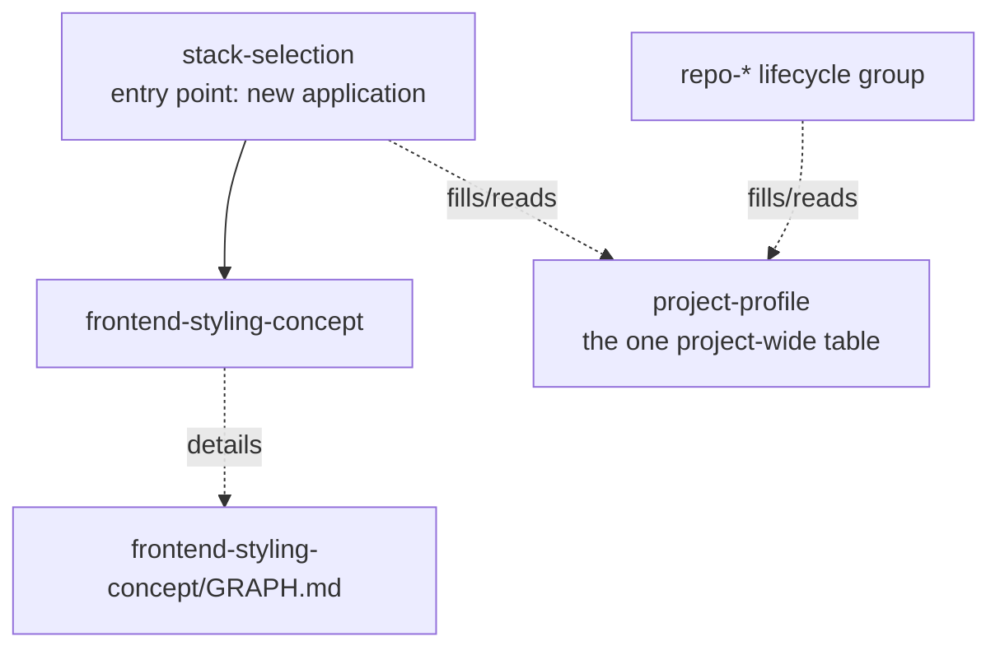

# Framework overview graph

Top-level domains and entry points only. Changes only when a new
domain/entry point appears — never grows past this. For what happens
inside a domain, open that domain's own `GRAPH.md` (linked below, once it
has more than one direct child).

## Nodes

- **`project-profile`** — not a domain, a cross-cutting utility: the one
  filled-in table describing a project's identity, stack, infra, and
  workflow (`.agents/project-profile.md` per project). Both
  `stack-selection` (creating new) and `repo-init` (connecting existing)
  read and write it; read it yourself before asking the owner a question
  it already answers.
- **`stack-selection`** — entry point for any brand-new application:
  app type → language/technology → routes into the matching domain's
  guided-setup skill. Read first when starting new work from scratch.
- **`frontend-styling-concept`** — domain: cross-platform styling
  architecture. Has children → see
  [frontend-styling-concept/GRAPH.md](frontend-styling-concept/GRAPH.md).
- **`repo-*` lifecycle group** — not a domain-architecture chain, a
  parallel category: repository lifecycle skills, each independent and
  triggered by its own task (not by `stack-selection`):
  `repo-init`, `repo-commit`, `repo-readme`, `repo-release`,
  `repo-cleanup`, `repo-agent-data`. No shared concept tier between them;
  no `GRAPH.md` needed for this group unless one of them later grows
  children of its own.
- **`framework-lint`** — not a domain, a meta-utility: checks `skills/`
  itself for broken links, orphaned skills, and `project-profile.md`
  "Governs" mismatches. Run after any change to the framework's own
  structure, not tied to `stack-selection` or any project.

No other domain exists yet (backend, mobile-native, desktop-native, ...).
Add a node here only when real work starts a new one — see `AGENTS.md` →
Delegation model.
