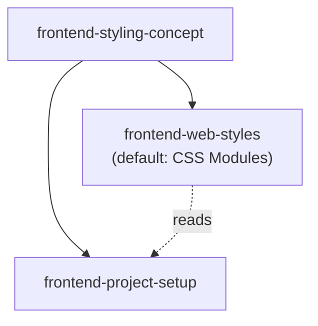

# frontend-styling-concept — direct children

Parent overview: [../GRAPH.md](../GRAPH.md). This file lists only this
domain's direct children — nothing further down unless one of them grows
children of its own.

## Nodes

- **`frontend-web-styles`** — implementation for browser/Electron/Tauri.
  Marked **default** for that platform row in
  `frontend-styling-concept/SKILL.md`. No alternative implementation
  exists yet (e.g. a future `frontend-web-styles-tailwind`); when one is
  added, it is named here too, as a non-default sibling.
- **`frontend-project-setup`** — guided step-by-step setup for a new
  frontend project; applies this concept and the chosen implementation
  without re-deciding them.

No React Native / other native UI engine implementation exists yet — see
the "Mechanism per platform" table in `SKILL.md` for the planned rows.
